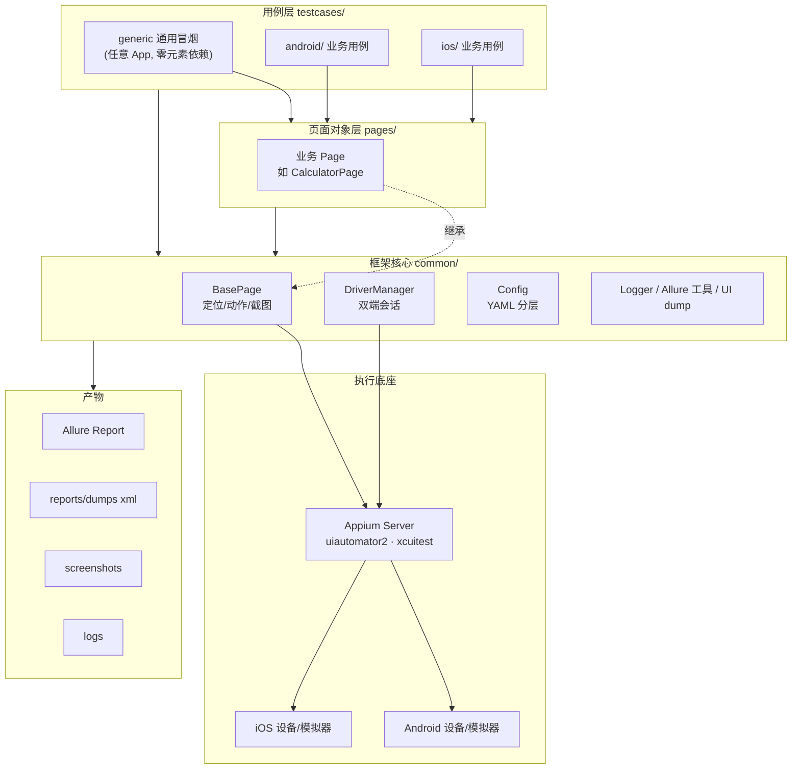
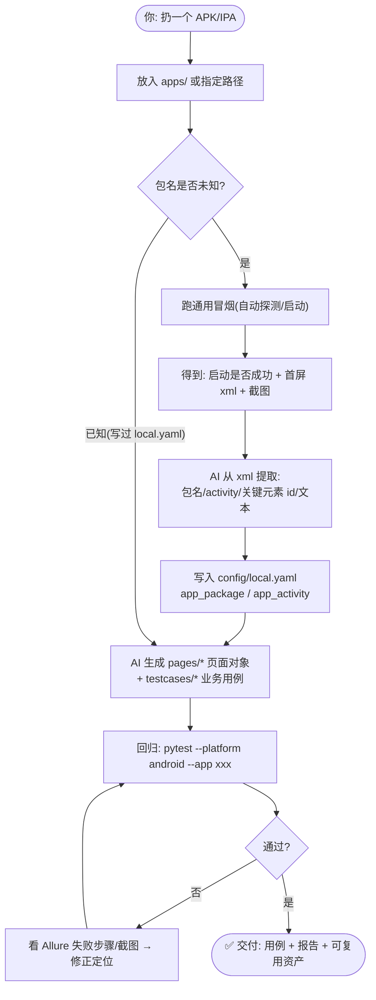
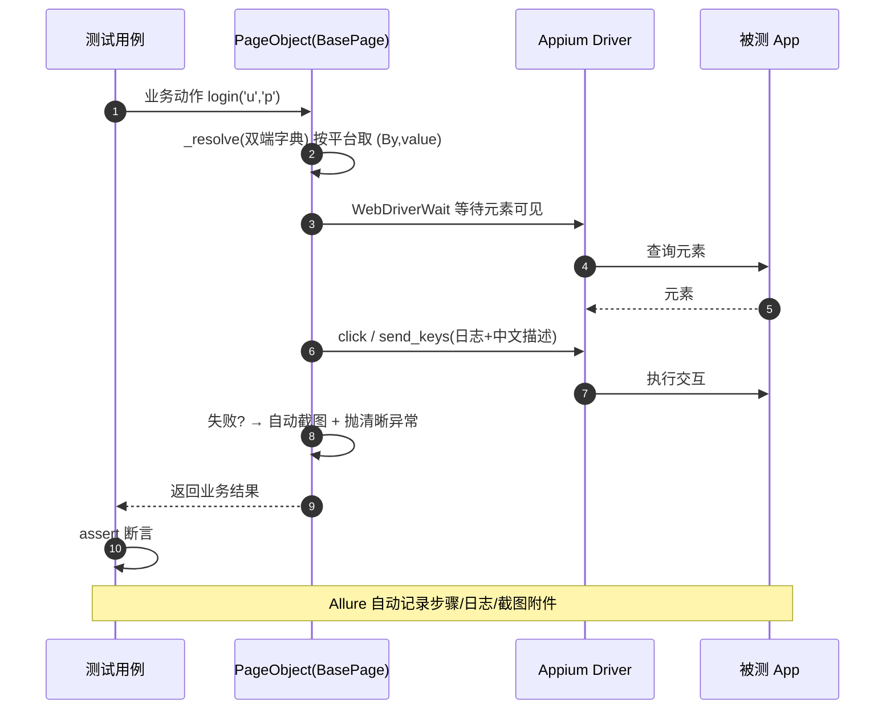
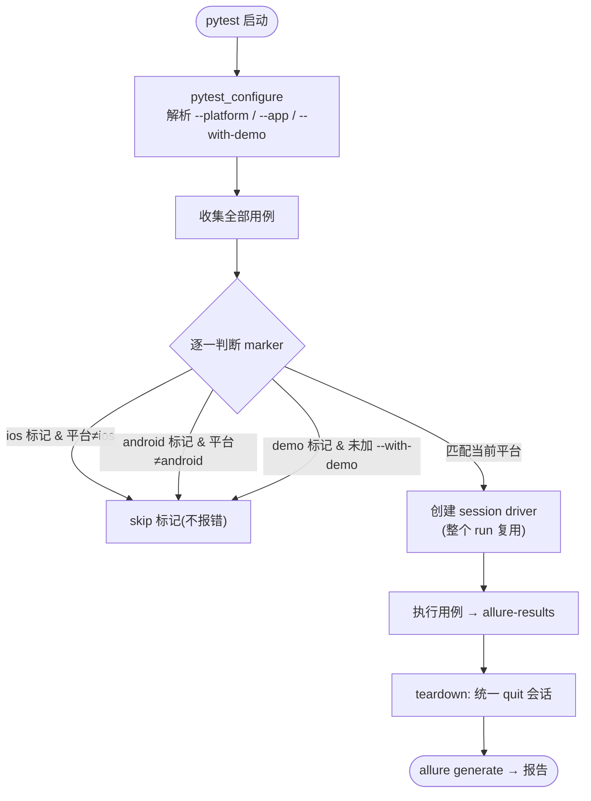
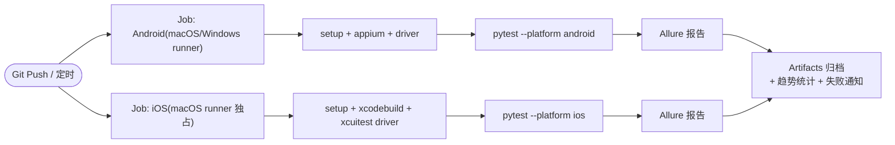

# 02 · AppAutoTest 流程图

> 用 Mermaid 描述全链路; 可在 Typora / VS Code(Mermaid 插件)/ GitHub / 方案总览.html 中渲染。
> 快捷在线预览: https://mermaid.live 粘贴对应代码即可。

---

## 图 1 · 系统架构图



---

## 图 2 · 一次完整测试运行流程(主流程)

```mermaid
flowchart LR
    S(["启动"]) --> ENV{环境检查<br/>Appium? 设备?"}
    ENV -- "未就绪" --> ERR["提示执行 setup_env / appium_install"] --> S
    ENV -- "就绪" --> RUN["pytest --platform &lt;平台&gt; --app &lt;App&gt;"]
    RUN --> CAP["组装 capabilities<br/>app 路径决策链"]
    CAP --> DRV["Appium 创建会话"]
    DRV --> INSTALL{"传了 --app?"}
    INSTALL -- "是" --> AP["安装 App → 启动"]
    INSTALL -- "否" --> LAUNCH["启动已安装的配置包"]
    AP & LAUNCH --> SMOKE["通用冒烟 5 步"]
    SMOKE --> P1["① 安装并启动"]
    SMOKE --> P2["② 首屏渲染"]
    SMOKE --> P3["③ 短时稳定性"]
    SMOKE --> P4["④ UI dump → xml"]
    SMOKE --> P5["⑤ 首屏截图"]
    P4 --> FEED["喂给 AI / 人工分析页面结构"]
    P1 & P2 & P3 & P5 --> ALLURE["Allure 结果 + 报告"]
    FEED --> POGEN["生成 PageObject & 业务用例"]
    POGEN --> REG["业务回归(全量用例)"]
    REG --> ALLURE
    ALLURE --> E(["交付: 报告/截图/xml 定位"])
```

---

## 图 3 · 新 App 接入 & 用例生产流程(「扔 App 给我」核心路径)



---

## 图 4 · Page Object 执行时序(运行时)



---

## 图 5 · 平台隔离与用例筛选(运行期决策)



---

## 图 6 · CI 流水线(建议落地形态)


